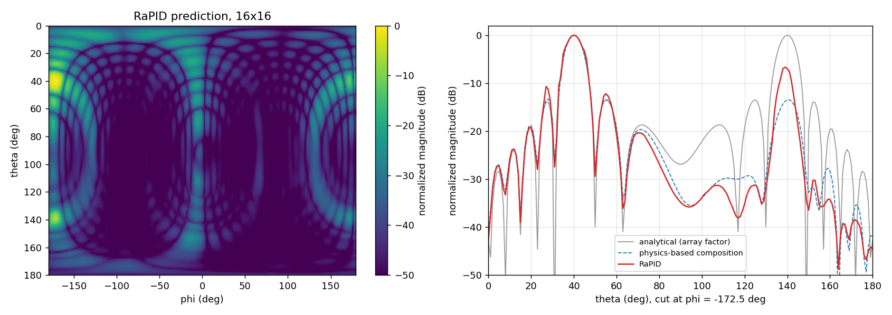

# RaPID

**RaPID: A Zero-Shot Radiation Pattern Surrogate Model Using Artificial Intelligence for Phased Array Antenna Design**

Mohammed Ayman Habib, Yi-Ching Liao, Natalie Hicks, Shruti Chakraborty, Hossein Naghavi, Morteza Fayazi
(University of Utah, University of Washington). Accepted at the Design, Automation and Test in Europe Conference (DATE).

RaPID predicts the full-wave far-field radiation pattern of large planar phased
arrays without any simulation of the large array. It is trained only on small
arrays (6x6 and smaller) and is evaluated zero-shot on 8x8 to 28x28 arrays.

It has two stages:

1. **Physics-based composition.** A 6x6 array is simulated once per steering
   direction, with each of its nine 2x2 sub-blocks excited in turn. These
   sub-block patterns already contain the mutual coupling of corner, edge and
   interior elements. A larger array is composed by tiling 2x2 sub-blocks and
   shifting each one to its position with a phase term. This reconstructs the
   main beam and much of the sidelobe structure.
2. **CNN correction.** A residual U-Net with a self-attention bottleneck and a
   multi-head output corrects the composed pattern, mainly in the null regions,
   where the composition is least accurate.



## Quick start

```bash
git lfs install                      # the checkpoint is stored with Git LFS
git clone https://github.com/medal-ece/RaPID.git
cd RaPID
pip install -r requirements.txt
```

Predict the pattern of an array from the example shipped in `examples/` (the
sub-block fields of one 6x6 simulation):

```bash
python -m scripts.predict --size 16
python -m scripts.predict --size 8 12 16 20 24 28
```

This writes the predicted pattern (`.npz`) and a figure to `results/predict/`.
It needs no dataset and runs on a CPU or a GPU.

Use RaPID as the surrogate inside a particle swarm optimiser (Section IV-E of
the paper):

```bash
python -m scripts.pso_inverse_design_8x8
```

The optimiser searches the element excitation phases of an 8x8 array, at uniform
amplitude, to push the sidelobes down towards a ceiling while the main beam
stays on target. Every candidate is scored by RaPID. It writes the phases of
the 64 elements, the predicted patterns and a figure to `results/pso_inverse_8x8/`.

## Repository layout

```
rapid/
  composition.py      physics-based composition, HFSS CSV parsers, ideal array factor
  model.py            RaPID CNN (residual U-Net, self-attention, multi-head output)
  losses.py           training loss
  inference.py        input channels, prediction, checkpoint loading
scripts/
  predict.py                  pattern of an NxN array from 6x6 sub-block fields
  pso_inverse_design_8x8.py   array design with RaPID as the surrogate
  build_compose.py            composition of an NxN array for a whole dataset
  build_training_set.py       training set (arrays up to 6x6 only)
  train.py                    training, including the ablation arms
  evaluate.py                 zero-shot evaluation against full-wave ground truth
baselines/                    BO-CNN, CV-GNN and IDM-NN, trained on the target array size
matlab/                       steering-direction sampling and analytical array patterns
checkpoints/rapid/            released model and input statistics
examples/                     sub-block fields of one steering direction
data/                         dataset layout and splits (see data/README.md)
```

## The released model

| | |
|---|---|
| Network | four-level residual U-Net, 48 base channels, eight-head self-attention bottleneck, 21.1 M parameters |
| Input | two 181 x 360 channels: the composed pattern, and the coupling gap (composed pattern minus the ideal array factor) |
| Output heads | bulk correction, deep-null refinement, elevation and azimuth sidelobe corrections, summed with learned weights |
| Training data | 6x6 sub-block patterns, whole 6x6 patterns and whole 4x4 patterns. No array larger than 6x6. |
| Training | Adam, learning rate 2e-4, batch 16, at most 200 epochs, learning rate halved on plateau, early stopping after 40 epochs |

The prediction is `composition + CNN correction`, normalised to the main-lobe
peak. The correction is used exactly as the network outputs it; it is only
switched off inside the 3 dB main-beam core, where the composition is kept.
No full-wave data of the evaluated array size enters the prediction, and nothing
is fitted on it. The input channels are standardised with statistics of composed
patterns of that size (shipped in `checkpoints/rapid/` for the sizes below).

### Zero-shot accuracy

Mean absolute error in dB against HFSS on 175 held-out steering directions per
array size, on peak-normalised 181 x 360 patterns. Produced by
`python -m scripts.evaluate` with the released checkpoint.

| Array | Analytical (array factor) | Composition only | RaPID, full pattern | RaPID, null region (< -20 dB) |
|---|---:|---:|---:|---:|
| 8x8 | 7.90 | 3.34 | **2.74** | 2.89 |
| 12x12 | 7.92 | 3.56 | **3.11** | 3.19 |
| 16x16 | 8.01 | 3.71 | **3.49** | 3.54 |
| 20x20 | 7.96 | 3.78 | **3.42** | 3.45 |
| 24x24 | 7.95 | 3.98 | **3.56** | 3.58 |
| 28x28 | 7.98 | 3.80 | **3.47** | 3.48 |

### Relation to the paper

This repository holds the current version of RaPID, which differs from the
configuration described in the paper in two ways. The numbers above are those
of the released checkpoint and are not identical to the paper's tables.

- **Input channels.** The network takes two channels (composed pattern and
  coupling gap) instead of six. The analytical pattern is contained in the
  coupling gap, and the remaining channels did not improve accuracy.
- **Training tasks.** The complex composition reproduces the 6x6 pattern
  exactly, so at the 6x6 scale it leaves nothing for the network to learn. The
  network is trained on two tasks instead: (a) the 6x6 pattern composed from
  sub-block magnitudes only, against the full-wave 6x6 pattern, and (b) a 4x4
  array composed from the 6x6 sub-blocks, against the full-wave 4x4 pattern. In
  task (b) the sub-blocks are reused outside the neighbourhood they were
  simulated in, which is the same source of error as when a larger array is
  composed. This is why the correction transfers to larger arrays as it is.

The method (composition from 6x6 sub-blocks, CNN correction, zero-shot
evaluation) and the network architecture are as described in the paper.

## Reproducing the pipeline

The raw HFSS exports are not part of the repository because of their size.
`data/README.md` describes the expected folders and CSV layouts.

```bash
# 1. composition, for training (4x4) and for every size to evaluate
python -m scripts.build_compose --size 4  --truth-dir data/4x4_array
python -m scripts.build_compose --size 28 --truth-dir data/28x28_array

# 2. training set (6x6 task + cross-scale 4x4 task) and training
python -m scripts.build_training_set
python -m scripts.train --run rapid_retrain

# 3. zero-shot evaluation
python -m scripts.evaluate --size 8 12 16 20 24 28
python -m scripts.evaluate --size 28 --ckpt checkpoints/rapid_retrain/rapid.pt
```

`--truth-dir` is only needed where ground truth is compared against (training
targets at 4x4, evaluation at the large sizes). Composing and predicting a large
array needs the 6x6 sub-block fields only.

**Ablation study (Table IV).** `scripts/train.py` has one switch per ablation
arm: `--no-composition` (the ideal array factor replaces the composition),
`--no-skips` (no U-Net skip connections) and `--no-heads` (single output head).
Evaluate the resulting checkpoint with `scripts/evaluate.py --ckpt`.

**Baselines (Table III, Fig. 4).** The three baselines are trained on full-wave
patterns of the target array size, on growing subsets of a 1,575-pattern pool,
and scored on the same test steering directions as RaPID:

```bash
python -m baselines.bocnn_bo --size 28                                   # BO-CNN: architecture search
python -m baselines.data_efficiency --size 28 --model bocnn --nc <n_c> --fc <f_c> ...
python -m baselines.data_efficiency --size 28 --model cvgnn_cx --lr 1e-3  # CV-GNN
python -m baselines.build_idm_targets --size 28                          # IDM-NN: dipole targets
python -m baselines.idm_ensemble_efficiency --size 28                    # IDM-NN
```

| Baseline | Reference |
|---|---|
| BO-CNN | Y. Zhang et al., "Efficient Array Pattern Prediction Using a Deep Learning Algorithm," EuCAP 2025 |
| CV-GNN | J. Jin et al., "Efficient Radiation Pattern Prediction of Array Antennas Based on Complex-Valued Graph Neural Networks," IEEE AWPL, 2022 |
| IDM-NN | N. B. Onat et al., "Constrained Infinitesimal Dipole Modeling-Assisted Ensemble Prediction of Embedded Element Patterns via Machine Learning," IEEE TAP, 2024 |

## Simulation cost of the training data

HFSS simulation plus post-processing time for one dataset per array size
(Table I of the paper). A model that is trained at the target size needs the
dataset of that size; RaPID needs small arrays only.

| Array | Dataset generation time (h) |
|---|---:|
| 4x4 | 2.79 |
| 6x6 | 3.24 |
| 8x8 | 3.70 |
| 12x12 | 5.72 |
| 16x16 | 11.70 |
| 20x20 | 13.64 |
| 24x24 | 66.02 |
| 28x28 | 179.12 |

The released model uses the 6x6 dataset and, for the cross-scale training task,
the 4x4 dataset.

## Antenna

Copper microstrip patch elements on an FR4-epoxy substrate at 2.4 GHz, on a
square lattice with half-wavelength (62.5 mm) spacing. Steering directions cover
0 to 60 degrees in elevation and all azimuths, placed with a centroidal Voronoi
tessellation (`matlab/cap_hex_centers.m`). Full-wave data: Ansys HFSS.

## Citation

```bibtex
@inproceedings{habib2027rapid,
  title     = {{RaPID}: A Zero-Shot Radiation Pattern Surrogate Model Using Artificial Intelligence for Phased Array Antenna Design},
  author    = {Habib, Mohammed Ayman and Liao, Yi-Ching and Hicks, Natalie and Chakraborty, Shruti and Naghavi, Hossein and Fayazi, Morteza},
  booktitle = {Design, Automation and Test in Europe Conference (DATE)},
  year      = {2027}
}
```

## License

MIT, see [LICENSE](LICENSE).
